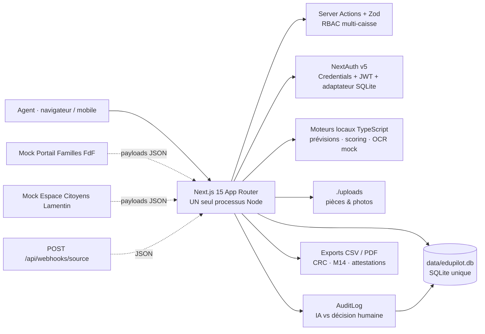

# ÉduPilot

> Plateforme de pilotage intelligent & **IA supervisée** pour les Caisses des Écoles de Martinique
> (Fort-de-France & Le Lamentin) —.back-office uniquement, 100 % autohébergé, zéro service externe.

ÉduPilot réunit dans **un seul processus Node.js** la prévision de fréquentation, la lutte contre le gaspillage, le traitement des aides sociales, la conformité HACCP, la planification et le journal d'audit. Chaque sortie d'IA est une **suggestion** : une personne habilitée doit la vérifier, l'ajuster si besoin et la valider. L'écart entre la proposition IA et la décision humaine est conservé dans la base.

---

## Démarrage rapide (une commande)

À la racine du dépôt :

```bash
pnpm install && pnpm dev
```

Ouvrez **http://localhost:3000**. Au premier accès, la base `edupilot/data/edupilot.db` est créée et remplie automatiquement (aucune commande supplémentaire). Comptes de démonstration :

| Profil | E-mail | Mot de passe |
|---|---|---|
| Directrice FdF (accès complet) | `directeur@fdf.edupilot.local` | `edupilot` |
| Responsable restauration | `restauration@fdf.edupilot.local` | `edupilot` |
| Agent aides sociales | `aides@fdf.edupilot.local` | `edupilot` |
| Directeur Lamentin (autre caisse) | `directeur@lamentin.edupilot.local` | `edupilot` |

Commandes utiles :

```bash
pnpm seed --force     # régénère intégralement le jeu de données
pnpm test             # tests unitaires Vitest
pnpm typecheck        # TypeScript strict
pnpm lint             # ESLint / Next.js
pnpm build            # build de production
pnpm e2e              # tests Playwright (navigateur à installer)
```

Ou, en conteneur unique :

```bash
cd edupilot && docker compose up --build
```

---

## Architecture



**Principe :** tout (interface, authentification, métier, prévisions, exports, stockage) tourne dans le même processus. Aucun appel réseau sortant n'est nécessaire au fonctionnement.

### Pile technique

- Next.js 15 (App Router) + TypeScript strict, Tailwind CSS, composants shadcn/ui, Radix UI, lucide-react
- Recharts (graphiques), TanStack Table (tableaux filtrables/triables), React Hook Form + Zod
- Drizzle ORM + `better-sqlite3` → **un unique fichier** `data/edupilot.db`
- NextAuth v5 (Credentials + JWT), adaptateur Drizzle sur les tables SQLite
- Statistiques en TypeScript pur (`simple-statistics`, moyennes mobiles, régression, saisonnalité)
- Vitest, Playwright, ESLint, Prettier, pnpm, Dockerfile monoprocessus

---

## Parcours de démonstration (5–7 minutes pour un Directeur de Caisse)

1. **Connexion.** Ouvrez `http://localhost:3000`, choisissez « Directrice · Fort-de-France » (`directeur@fdf.edupilot.local` / `edupilot`).
2. **Tableau de bord (1 min).** Observez les KPI (couverts prévus vs réels, pertes, budget, aides ouvertes), les quatre graphiques Recharts, l'alerte HACCP et les prévisions à confirmer. Les boutons **Export CSV** et **Rapport CRC (PDF)** produisent de vrais fichiers téléchargeables.
3. **IA Restauration (2 min).** Cliquez sur « Valider les prévisions IA ». Sur la page, lisez l'historique d'exactitude (MAE/MAPE), puis ouvrez une suggestion avec **Adjust & Valider**. Modifiez les couverts (ex. 95 à la place de 91), indiquez un motif, puis validez. La fiche affiche immédiatement **Suggestion IA vs décision humaine** et l'écart. Le tout est écrit dans le journal d'audit.
4. **Aides sociales (1,5 min).** Ouvrez « Aides sociales ». Déposez une demande, cliquez sur **Scorer avec l'IA** : le score de 0 à 100 s'affiche avec ses composantes. Seule une personne habilitée peut ensuite accorder ou refuser, avec un motif. Pour un dossier validé, téléchargez l'**attestation PDF**.
5. **HACCP & planning (1 min).** Depuis le tableau de bord, ouvrez l'alerte HACCP : le contrôle non conforme est visible avec sa température. Ajoutez un contrôle, puis constatez que le planning affiche les couverts prévus par l'IA et que le pointage est actionnable.
6. **Interopérabilité (30 s).** Sur « Interopérabilité », synchronisez un flux du Portail Familles : la charge utile JSON et sa version normalisée apparaissent dans la table. Le récepteur de webhook local est documenté.
7. **Administration (30 s).** Onglet **Audit** : filtrez par action `PREDICTION_VALIDATED` et comparez `aiSuggestion` / `humanDecision`. Onglet **Données & RGPD** : export d'une famille ou régénération du jeu (`RESET`).

---

## Déploiement pas-à-pas

Guide complet (systemd, Plesk/cPanel, Docker, sauvegardes, mises à jour) : [`edupilot/DEPLOIEMENT.md`](edupilot/DEPLOIEMENT.md).

## Fonctionnement sur « site mutualisé » sans BDD externe

| Contrainte | Réponse ÉduPilot |
|---|---|
| Une seule base | `data/edupilot.db`, fichier SQLite créé et migré au premier accès |
| Pas de PostgreSQL/Redis/Supabase… | Aucun client de base externe, aucun cache applicatif externe |
| Pas d'IA externe | Prévisions et scoring calculés dans le processus Node (`src/lib/ml/`) |
| Pas d'auth externe | NextAuth Credentials + JWT, adaptateur Drizzle sur SQLite local |
| Uploads | `./uploads/aides` et `./uploads/haccp`, validation des types/tailles |
| Un seul processus | Next.js unique (`next start`) — pas de microservice, pas de worker séparé |
| Portabilité | Le dossier `edupilot/` contient l'app, la base et les uploads ; volumes Docker équivalents |
| Configuration | `.env` uniquement pour `AUTH_SECRET`, `SEED_PASSWORD` et `PORT` |

Déploiement mutualisé typique : copier le dossier, `pnpm install --prod=false`, `pnpm build`, puis lancer `pnpm start` derrière le reverse-proxy de l'hébergeur (ou via `docker compose up`). Prévoir un `AUTH_SECRET` aléatoire long, un backup du dossier `data/` et des droits d'écriture sur `data/` et `uploads/`.

---

## Structure du projet

```text
.
├── package.json / pnpm-workspace.yaml   # workspace pnpm, scripts racine
├── edupilot/
│   ├── src/
│   │   ├── app/
│   │   │   ├── (auth)/login/            # connexion
│   │   │   ├── (app)/dashboard/         # tableau de bord direction
│   │   │   ├── (app)/predictions/       # IA restauration + validation
│   │   │   ├── (app)/aides/             # aides sociales + attestations
│   │   │   ├── (app)/haccp/             # HACCP Lite
│   │   │   ├── (app)/planning/          # planning & pointage
│   │   │   ├── (app)/interop/           # mocks de portails
│   │   │   ├── (app)/admin/             # paramètres, RBAC, audit, RGPD
│   │   │   └── api/                     # auth, exports, webhook, RGPD
│   │   ├── actions/                     # Server Actions (vérif. Zod + RBAC)
│   │   ├── components/                  # UI, charts, formulaires, shell
│   │   ├── db/                          # schéma Drizzle + client SQLite
│   │   ├── lib/
│   │   │   ├── ml/                      # predict.ts, aid-score.ts, calendar.ts
│   │   │   ├── mocks/                   # payloads d'interopérabilité
│   │   │   ├── auth/ audit.ts queries.ts pdf.ts permissions.ts
│   │   ├── auth.ts                      # NextAuth v5
│   ├── scripts/                         # seed.ts, seed-data.ts, gen-icons.mjs
│   ├── drizzle/                         # migrations SQL générées
│   ├── data/edupilot.db                 # base locale (générée)
│   ├── uploads/                         # fichiers locaux (générés)
│   ├── tests/ + playwright/             # Vitest + Playwright
│   ├── Dockerfile + docker-compose.yml
│   └── .env.example
├── README.md                             # ce document
└── docs/benchmark.md                     # contenu original du dépôt
```

---

## Données de démonstration

Le seed (`pnpm seed --force`) génère de façon déterministe :

- **2 caisses** (Fort-de-France, Le Lamentin), **12 agents** couvrant les 6 rôles, **10 écoles**
- **288 enfants** dans 240 familles avec quotients familiaux et adresses martiniquaises
- **90 jours** de fréquentation (910 enregistrements) avec effets Carnaval, congés, chaleur et week-end
- Menus de produits locaux (colombo, accras, blaff, bananes plantains, igname…)
- **70 prévisions** sur 7 jours, des validations humaines et un historique d'exactitude
- 34 demandes d'aide à différents stades, 34 documents, contrôles HACCP, planning, pointages, alertes, flux d'interop et journal d'audit

---

## Conformité & limites connues

- **Human-in-the-loop appliqué dans le backend** : une prévision ou une aide ne peut être validée que par un rôle habilité, et uniquement depuis une suggestion calculée. Aucun bouton « approbation automatique » n'existe.
- **Traçabilité** : `audit_logs` conserve `aiSuggestion` et `humanDecision` avec acteur et horodatage.
- **RGPD** : export JSON par famille, suppression en cascade, aucune donnée ne quitte l'instance.
- **P1 (stubs explicitement signalés dans l'UI et le README)** : OCR avancé (stub local), PWA hors-ligne complet (manifest + service worker minimal), édition CRC/M14 détaillée, chatbot interne, analytique multi-caisse avancée.
- Le PDF généré est un document **de démonstration** (PDF 1.4 minimal, Helvetica) et ne remplace pas un état CRC/M14 réglementaire.
- L'exactitude du modèle dépend du volume d'historique : les 7 premiers jours utilisent un démarrage à froid explicite.
- Le service worker est volontairement minimal : pas de synchronisation hors-ligne des décisions (P1).

---

## À propos de ce dépôt

Ce dépôt est à l'origine un banc d'essai de quatre modèles de programmation. Le contenu historique est conservé dans [`docs/benchmark.md`](docs/benchmark.md) ; les builds d'origine restent dans `astra-6.2/`, `fable-5.2/`, `opus-5.5/` et `sol-6.2/`. ÉduPilot est l'application livrée dans ce workspace.
